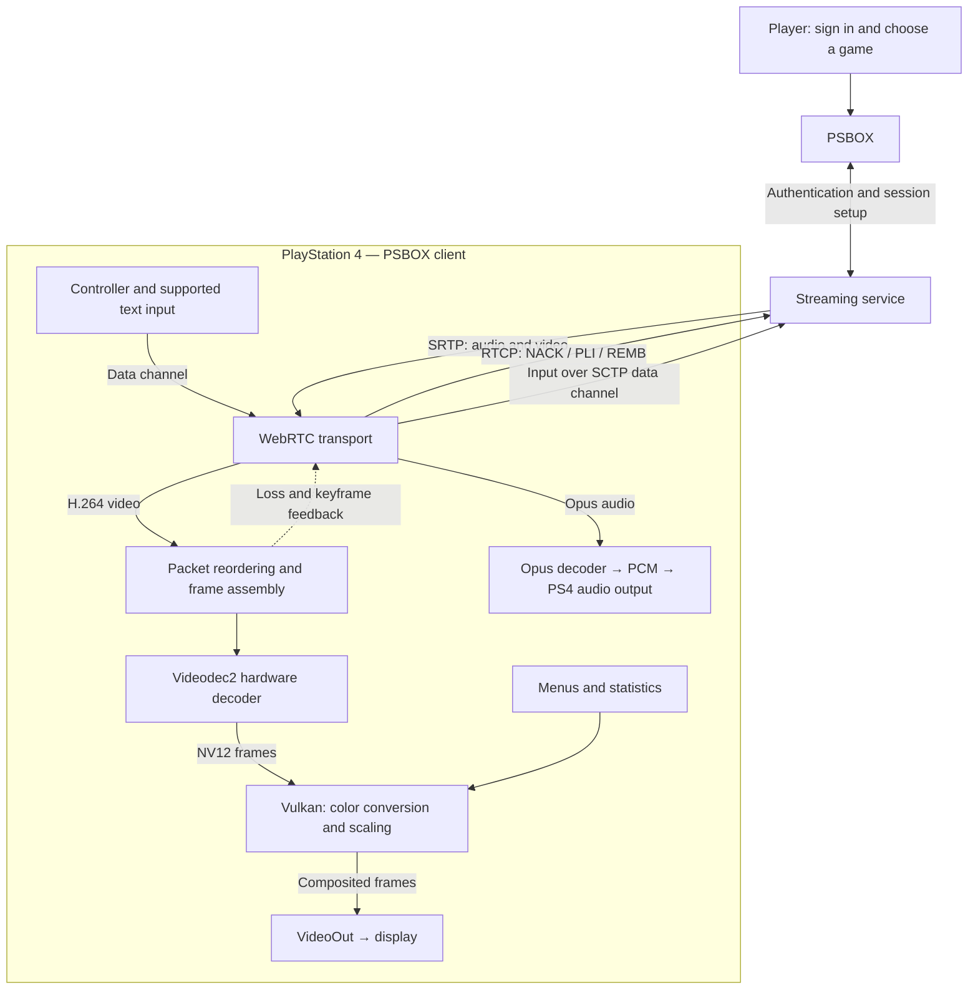
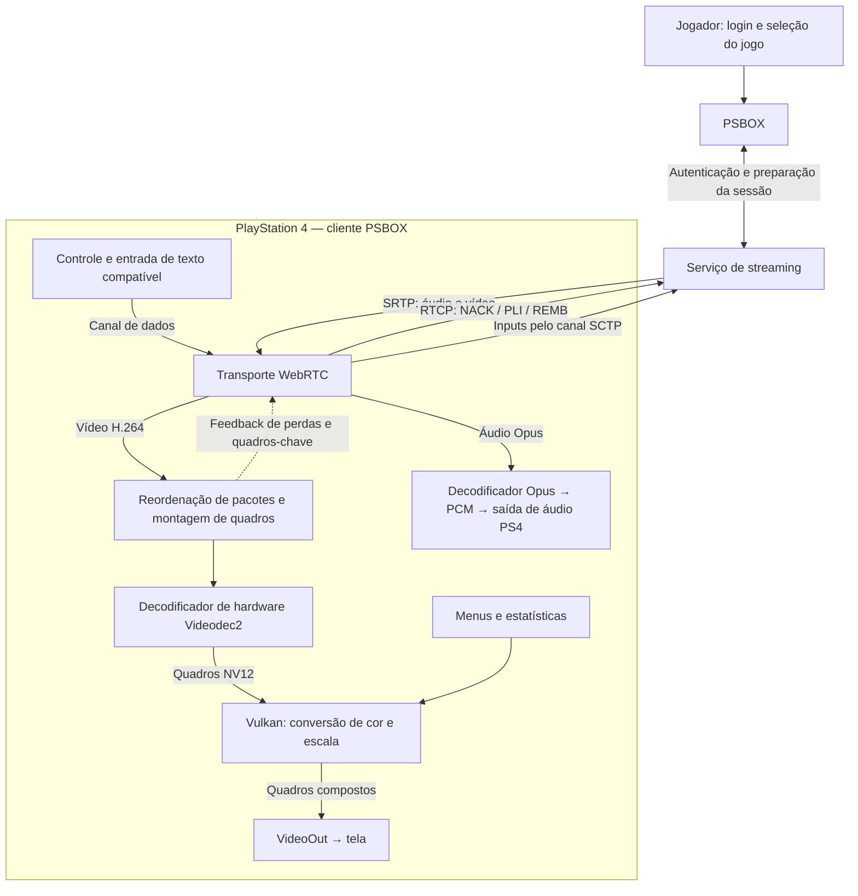

# PSBOX for PS4

**An unofficial, experimental homebrew client for streaming games to PlayStation 4.**

[🇧🇷 Leia em português](#psbox-para-ps4) · [Download Beta 0.1](https://github.com/Lucky73747/PSBOX-PS4/releases/latest) · [Changelog](docs/CHANGELOG.md)

*English is the primary version of this document.*

## About the project

PSBOX lets you stream games to a PS4 using your own account and access to the streaming service. It is an independent homebrew project exploring what can be built for the console.

PSBOX is not affiliated with, endorsed by, or operated by Microsoft, Xbox, Sony, or PlayStation. It does not provide games, accounts, subscriptions, or access rights. You are responsible for having the required account, subscription, and permission to play each game.

The project is experimental and under active development. Bugs, limitations, and regressions may occur, and not every change has been tested on a physical PS4.

## AI assistance and development

PSBOX is developed by one person, with limited time and resources. I use AI tools to help with repetitive programming and code review, and I also study community projects to understand the PS4 architecture. The design choices, integration, testing, and project direction remain part of my work.

I do not want to hide the use of AI, or let it obscure the human work involved. AI assistance makes it possible for me to attempt work that would otherwise be difficult to do alone. It can also produce mistakes, so generated changes still need review and testing.

## Features and current status

The PS4 client uses hardware H.264 decoding through Videodec2 and Vulkan rendering. It includes bilinear scaling, AMD FidelityFX Super Resolution 1 (EASU/RCAS), and 30 or 60 FPS presentation options.

These settings are requests and client-side presentation choices. They do not guarantee a fixed stream resolution, bitrate, frame rate, or latency; results depend on the service, network, game, account, and console.

> PSBOX is experimental. A successful build does not confirm that a feature works or performs well on a PS4. Console behavior should be described as tested only when it has been observed on the console.

## How to use

1. Download `PSBOX-0.1.0-beta-b1.pkg` from the [latest release](https://github.com/Lucky73747/PSBOX-PS4/releases/latest). Compare its SHA-256 with the attached `SHA256SUMS`.
2. Install it on a PS4 with a compatible homebrew environment and network access. A retail PS4 without homebrew support cannot install this package. A complete firmware compatibility list is not yet available.
3. Open **PSBOX**, follow the account sign-in prompts, then choose an available game from the catalog.

**Current beta:** app **0.1.0**, build **1**, title ID `PSBX00001`, installer version `00.01`. It installs separately from the older `XCHM00001` app. Existing account/profile data is not automatically migrated or cleared by this title ID change.

The package was compiled and packaged on [GitHub Actions](https://github.com/Lucky73747/PSBOX-PS4/actions/runs/39092806118). This confirms the build, not successful operation on a PS4. Console validation of this exact package remains pending. See the [initial changelog and known issues](docs/CHANGELOG.md), including keyboard text delivery, session closing, audio synchronization and video recovery.

Obtain packages only from sources you trust. Consider the risks of using experimental, unofficial software with your account and console.

## How it works

At a high level, PSBOX authenticates with the user's account, negotiates a streaming session, receives audio and video, and presents the decoded video on the PS4. The diagram shows the main data paths; implementation details and fallback paths can change as development continues.



REMB communicates a requested receive bitrate; it does not force the service to deliver that bitrate. The diagram summarizes the normal PS4 path; fallback paths and recovery are omitted for clarity. Text delivery still needs validation for each game.

## Bug reports and logs

**Bug reports need logs to be actionable.** Include the PSBOX build/version, PS4 model, what you were doing, steps to reproduce, and the relevant logs. Without logs, I may be unable to identify or fix the problem.

Reproduce the issue, note the approximate time, then collect both the application log and the system Klog when possible. Share them in the appropriate bug-report thread on Discord.

<details>
<summary><strong>Application log: xcloud.log</strong></summary>

The file is stored on the PS4 at:

```text
/data/PSBOX/xcloud.log
```

Connect to the PS4's FTP server with an FTP client, open `/data/PSBOX/`, and download `xcloud.log`. If possible, reproduce the issue immediately before downloading the log so the relevant events are near the end of the file.

</details>

<details>
<summary><strong>System log: Klog</strong></summary>

Klog can contain system errors and crash records that are absent from `xcloud.log`. Capture it from a computer while reproducing the issue, using a PS4 Klog viewer or the included [PSBOX PC Manager](tools/ps4/ps4-pc-manager/). Save the Klog and note the PSBOX version and time of the incident so it can be compared with `xcloud.log`.

</details>

<details>
<summary><strong>Protect private information</strong></summary>

Before sharing logs, inspect and redact access or refresh tokens, cookies, authorization headers, sign-in codes, account identifiers, session data, SDP, and ICE candidates. Do not post credentials or complete session dumps. Share logs only in the private or designated bug-report channel, and remove any sensitive data from attachments.

</details>

## Contributing

Reproducible bug reports, testing, suggestions, code review, and performance work are welcome. For experiments, include the status, results, and known issues. Changes should be tested and their test conditions described where possible.

Because this is a solo project, replies and fixes may take time. Donations are optional and are never required to participate or receive help.

## Discord and community

The Discord is a small development lab for my projects, not a PSBOX-only server. It is a place to share homebrew work, experiments, tests, and discoveries.

[Join the Discord](https://discord.gg/ap5GvUQsxs)

## Support future projects

For ideas, collaboration, or other contributions, contact [stillness.dev@gmail.com](mailto:stillness.dev@gmail.com). Hardware donations are also welcome and may help make future experiments possible. All support is optional.

## Building from source

See [`BUILDING.md`](BUILDING.md) for build prerequisites and instructions.

The repository includes the PS4 application source and some dependencies used by CMake. It does not include the external PS4 SDK, platform toolchain, external platform libraries, generated build artifacts, or PKG packages in the source tree. Downloadable packages are attached separately to releases.

A successful build confirms compilation and packaging only. It does not confirm that the application runs or performs correctly on a console.

## Accounts, services, and risks

PSBOX is an independent client for streaming games you are authorized to play, using your own account and access to the service. It does not operate or control the streaming service and cannot guarantee availability or uninterrupted operation.

Review the terms that apply to your Microsoft/Xbox and PlayStation accounts, as well as local laws. Unofficial software and account use may carry risks, including service or account restrictions imposed by the platform providers. The maintainers cannot control or reverse those decisions. Use PSBOX at your own risk and subject to rights that cannot legally be excluded.

Xbox, Xbox Cloud Gaming, Game Pass, PlayStation, and related marks belong to their respective owners. Their mention identifies compatible services or platforms and does not imply endorsement.

## License and acknowledgements

PSBOX source code is licensed under **GPL-3.0-or-later**; see [`LICENSE`](LICENSE). Third-party components retain their own terms. Consult [`THIRD_PARTY_NOTICES.md`](THIRD_PARTY_NOTICES.md), `licenses/`, and the dependency trees. External SDK and platform-component terms must also be checked before redistributing binaries.

The PS4 port builds on work from [RafaelNGP's PS5 cloud-streaming project](https://github.com/RafaelNGP/xbox-cloud-gaming-ps5). I am grateful to its author and contributors for the code and research that helped make this project possible. No artwork or profile image from that project is included or claimed by PSBOX.

PSBOX also uses or depends on community projects including **libdatachannel** (with libjuice, usrsctp, libsrtp, nlohmann/json, and plog), **Mbed TLS**, **Opus**, **AMD FidelityFX FSR 1**, **Nayuki QR Code generator**, **stb**, and the **Inter** typeface. The external build environment involves projects such as **OpenOrbis PS4 Toolchain**, **orbis-porting-kit**, **orbis-compat**, **Mesa for PS4**, and **SDL**.

This list is an acknowledgement, not a replacement for license notices, and does not imply endorsement by the projects or authors named above.

---

# PSBOX para PS4

**Um cliente homebrew não oficial e experimental para transmitir jogos ao PlayStation 4.**

[English](#psbox-for-ps4) · [Baixar Beta 0.1](https://github.com/Lucky73747/PSBOX-PS4/releases/latest) · [Changelog](docs/CHANGELOG.md)

*Esta é a tradução em português da documentação principal em inglês.*

## Sobre o projeto

O PSBOX permite transmitir jogos para um PS4 usando sua própria conta e o acesso ao serviço de streaming. É um projeto homebrew independente que explora o que pode ser desenvolvido para o console.

O PSBOX não tem vínculo, endosso ou operação da Microsoft, Xbox, Sony ou PlayStation. Não fornece jogos, contas, assinaturas nem direitos de acesso. Você é responsável por possuir a conta, assinatura e autorização necessárias para jogar cada título.

O projeto é experimental e está em desenvolvimento ativo. Podem ocorrer bugs, limitações e regressões, e nem toda alteração foi testada em um PS4 físico.

## Uso de IA e desenvolvimento

O PSBOX é desenvolvido por uma pessoa, com tempo e recursos limitados. Uso ferramentas de IA para ajudar em tarefas repetitivas de programação e revisão de código, e também estudo projetos da comunidade para compreender a arquitetura do PS4. As decisões de projeto, integração, testes e direção continuam fazendo parte do meu trabalho.

Não quero esconder o uso de IA nem deixar que ele apague o trabalho humano envolvido. A assistência da IA torna possível tentar tarefas que seriam difíceis de realizar sozinho. Ela também pode cometer erros, por isso as alterações geradas ainda precisam de revisão e testes.

## Funcionalidades e estado atual

O cliente para PS4 usa decodificação H.264 por hardware via Videodec2 e renderização Vulkan. Inclui escala bilinear, AMD FidelityFX Super Resolution 1 (EASU/RCAS) e opções de apresentação a 30 ou 60 FPS.

Essas configurações são solicitações e escolhas de apresentação feitas pelo cliente. Elas não garantem resolução, bitrate, taxa de quadros ou latência fixos; os resultados dependem do serviço, da rede, do jogo, da conta e do console.

> O PSBOX é experimental. Uma compilação bem-sucedida não confirma que um recurso funciona ou tem bom desempenho no PS4. O comportamento no console só deve ser descrito como testado quando tiver sido observado nele.

## Como usar

1. Baixe `PSBOX-0.1.0-beta-b1.pkg` na [release mais recente](https://github.com/Lucky73747/PSBOX-PS4/releases/latest). Compare o SHA-256 com o arquivo `SHA256SUMS` anexado.
2. Instale em um PS4 com ambiente homebrew compatível e acesso à rede. Um PS4 original sem suporte a homebrew não instala esse pacote. Ainda não existe uma lista completa de firmwares compatíveis.
3. Abra **PSBOX**, siga as instruções de login e escolha um jogo disponível no catálogo.

**Beta atual:** app **0.1.0**, build **1**, identificador `PSBX00001`, instalador `00.01`. Instala separadamente do antigo `XCHM00001`. A mudança de identificador não migra nem apaga automaticamente os dados de conta e perfil existentes.

O pacote foi compilado e empacotado no [GitHub Actions](https://github.com/Lucky73747/PSBOX-PS4/actions/runs/39092806118). Isso confirma a compilação, não o funcionamento no PS4. A validação desse pacote exato no console continua pendente. Consulte o [changelog inicial e os problemas conhecidos](docs/CHANGELOG.md), incluindo entrega do texto do teclado, encerramento da sessão, sincronização de áudio e recuperação de vídeo.

Baixe pacotes somente de fontes confiáveis. Considere os riscos de usar software experimental e não oficial com sua conta e seu console.

## Como funciona

Em linhas gerais, o PSBOX autentica a conta do usuário, negocia uma sessão de streaming, recebe áudio e vídeo e apresenta no PS4 o vídeo decodificado. O diagrama mostra os principais caminhos de dados; detalhes da implementação e caminhos alternativos podem mudar durante o desenvolvimento.



O REMB comunica um bitrate solicitado; não obriga o serviço a entregar essa taxa. O diagrama resume o caminho normal do PS4, sem detalhar os caminhos alternativos e a recuperação. A entrega de texto ainda precisa ser validada em cada jogo.

## Relatos de bugs e logs

**Relatos de bugs precisam de logs para serem investigáveis.** Inclua build/versão do PSBOX, modelo do PS4, o que estava fazendo, passos para reproduzir e os logs relevantes. Sem logs, talvez eu não consiga identificar nem corrigir o problema.

Reproduza o problema, anote o horário aproximado e, quando possível, capture tanto o log do aplicativo quanto o Klog do sistema. Envie-os no tópico apropriado para bugs no Discord.

<details>
<summary><strong>Log do aplicativo: xcloud.log</strong></summary>

O arquivo fica no PS4 em:

```text
/data/PSBOX/xcloud.log
```

Conecte-se ao servidor FTP do PS4 com um cliente FTP, abra `/data/PSBOX/` e baixe `xcloud.log`. Se possível, reproduza o problema logo antes de baixar o log para que os eventos relevantes estejam perto do final do arquivo.

</details>

<details>
<summary><strong>Log do sistema: Klog</strong></summary>

O Klog pode registrar erros do sistema e falhas que não aparecem em `xcloud.log`. Capture-o em um computador enquanto reproduz o problema, usando um visualizador de Klog para PS4 ou o [PSBOX PC Manager](tools/ps4/ps4-pc-manager/) incluído no projeto. Salve o Klog e anote a versão do PSBOX e o horário do incidente para compará-lo com `xcloud.log`.

</details>

<details>
<summary><strong>Proteja sua privacidade</strong></summary>

Antes de compartilhar logs, revise e remova tokens de acesso ou atualização, cookies, cabeçalhos de autorização, códigos de login, identificadores de conta, dados da sessão, SDP e candidatos ICE. Não publique credenciais nem capturas completas de sessão. Compartilhe os logs somente no canal privado ou tópico de bugs designado e remova dados sensíveis dos anexos.

</details>

## Como contribuir

Relatos reproduzíveis de bugs, testes, sugestões, revisão de código e trabalho de desempenho são bem-vindos. Ao compartilhar experimentos, informe o estado, os resultados e os problemas conhecidos. Sempre que possível, descreva as condições dos testes e o que foi verificado.

Como o projeto é mantido por uma pessoa, respostas e correções podem demorar. Doações são opcionais e nunca são necessárias para participar ou receber ajuda.

## Discord e comunidade

O Discord é um pequeno laboratório de desenvolvimento para meus projetos, não um servidor exclusivo do PSBOX. É um espaço para compartilhar homebrew, experimentos, testes e descobertas.

[Entre no Discord](https://discord.gg/ap5GvUQsxs)

## Apoie projetos futuros

Para ideias, colaboração ou outras contribuições, escreva para [stillness.dev@gmail.com](mailto:stillness.dev@gmail.com). Doações de hardware também são bem-vindas e podem ajudar a viabilizar experimentos futuros. Todo apoio é opcional.

## Compilação a partir do código-fonte

Consulte [`BUILDING.md`](BUILDING.md) para os pré-requisitos e as instruções de compilação.

O repositório inclui o código-fonte do aplicativo para PS4 e algumas dependências usadas pelo CMake. Não inclui o SDK externo do PS4, a toolchain da plataforma, bibliotecas externas da plataforma, artefatos de compilação gerados nem pacotes PKG na árvore de código. Os pacotes para download ficam separados, nos anexos das releases.

Uma compilação bem-sucedida confirma somente a compilação e o empacotamento. Ela não confirma que o aplicativo executa ou tem o desempenho esperado no console.

## Contas, serviços e riscos

O PSBOX é um cliente independente para transmitir jogos que você tem autorização para jogar, usando sua própria conta e acesso ao serviço. Ele não opera nem controla o serviço de streaming e não pode garantir disponibilidade ou funcionamento contínuo.

Verifique os termos aplicáveis às suas contas Microsoft/Xbox e PlayStation, além das leis locais. O uso de software não oficial e de contas pode envolver riscos, incluindo restrições de serviço ou de conta impostas pelas plataformas. Os mantenedores não controlam nem podem reverter essas decisões. Use o PSBOX por sua conta e risco, respeitados os direitos que não possam ser legalmente excluídos.

Xbox, Xbox Cloud Gaming, Game Pass, PlayStation e marcas relacionadas pertencem a seus respectivos proprietários. A menção identifica serviços ou plataformas compatíveis e não implica endosso.

## Licença e agradecimentos

O código-fonte do PSBOX está licenciado sob **GPL-3.0-or-later**; consulte [`LICENSE`](LICENSE). Componentes de terceiros mantêm seus próprios termos. Consulte [`THIRD_PARTY_NOTICES.md`](THIRD_PARTY_NOTICES.md), `licenses/` e as árvores das dependências. Os termos de SDKs externos e componentes da plataforma também devem ser verificados antes de redistribuir binários.

O porte para PS4 se baseia no trabalho do [projeto de streaming para PS5 de RafaelNGP](https://github.com/RafaelNGP/xbox-cloud-gaming-ps5). Agradeço ao autor e aos colaboradores pelo código e pela pesquisa que ajudaram a tornar este projeto possível. O PSBOX não inclui nem reivindica artes ou imagens de perfil daquele projeto.

O PSBOX também usa ou depende de projetos da comunidade, incluindo **libdatachannel** (com libjuice, usrsctp, libsrtp, nlohmann/json e plog), **Mbed TLS**, **Opus**, **AMD FidelityFX FSR 1**, **QR Code generator de Nayuki**, **stb** e a fonte **Inter**. O ambiente externo de compilação envolve projetos como **OpenOrbis PS4 Toolchain**, **orbis-porting-kit**, **orbis-compat**, **Mesa para PS4** e **SDL**.

Esta lista é um agradecimento, não substitui os avisos de licença e não implica endosso pelos projetos ou autores mencionados.
